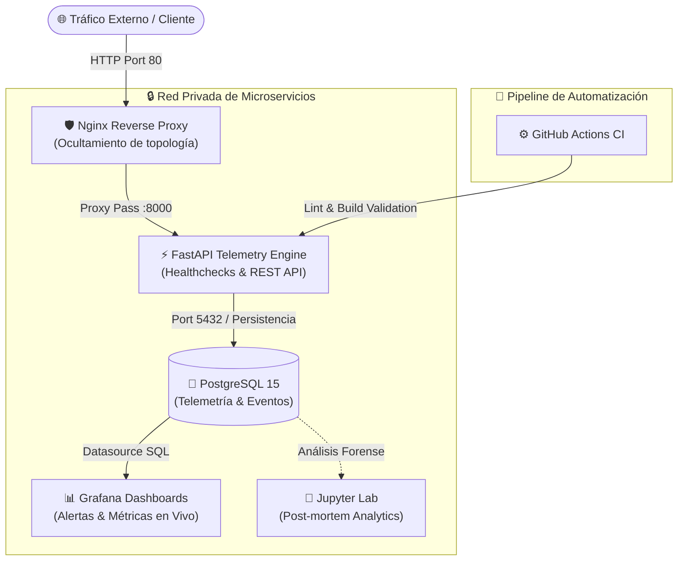

# OpsPulse 🚀 | Observability & Automated Infrastructure Pipeline

[](https://github.com/andreycombita12/OpsPulse/actions)


**OpsPulse** es una plataforma de infraestructura y observabilidad contenerizada orientada a resiliencia y alta disponibilidad. El proyecto simula un entorno de producción moderno aplicando principios de la ingeniería de control (bucles cerrados de retroalimentación, telemetría continua y automatización ante fallos) a los ecosistemas **DevOps, Cloud e Ingeniería de Confiabilidad de Sitios (SRE)**.

---

## 🏗️ Arquitectura del Sistema

El sistema utiliza **Docker Compose** para orquestar microservicios desacoplados con segmentación de redes (`frontend_net` / `backend_net`), controlados mediante políticas de autosanado y dependencias condicionales (`service_healthy`).



---

## 🔥 Capacidades Clave de SRE & Infraestructura

* **Orquestación Resiliente & Self-Healing:** Configuración de `healthchecks` nativos a nivel de aplicación y base de datos con arranque condicional (`depends_on: condition: service_healthy`) y políticas de reinicio automático (`restart: unless-stopped`) ante caídas.
* **Seguridad por Diseño (Network Segmentation):** Nginx actúa como punto único de entrada seguro en el puerto 80. Los servicios de backend y la base de datos se ejecutan en redes privadas aisladas (`backend_net`), impidiendo la exposición directa de puertos sensibles a internet.
* **Observabilidad y Métricas en Tiempo Real:** Dashboards interactivos en Grafana aprovisionados automáticamente como código (`datasources.yml`), con disparadores de alerta basados en consultas SQL para detectar cuellos de botella o anomalías.
* **Estrategia de Recuperación ante Desastres (DR):** Automatización de copias de seguridad de la base de datos con scripts de `pg_dump` para restauración rápida del estado.
* **Integración Continua (CI):** Pipeline automatizado en **GitHub Actions** (`.github/workflows/ci.yml`) que valida estándares de código, dependencias y compila imágenes Docker en cada push o Pull Request a la rama `main`.

---

## ☁️ Compatibilidad Cloud & Arquitectura Microsoft Azure

OpsPulse fue diseñado bajo los lineamientos de arquitectura en la nube (alineados a las mejores prácticas de **Microsoft Certified: Azure Fundamentals AZ-900**):

| Servicio Local | Equivalente en Microsoft Azure | Rol en Arquitectura Cloud |
|---|---|---|
| **Contenedores Docker** | **Azure Container Apps (ACA)** / App Service | Despliegue de microservicios sin gestión de servidores. |
| **PostgreSQL 15** | **Azure Database for PostgreSQL (Flexible Server)** | Base de datos gestionada con alta disponibilidad y backups automáticos. |
| **Nginx Reverse Proxy** | **Azure Application Gateway** / Front Door | Enrutamiento seguro, terminación SSL y balanceo de carga L7. |
| **GitHub Actions** | **Azure DevOps Pipelines** / GitHub Actions | Integración y despliegue continuo (CI/CD) automatizado. |
| **Grafana / Alertas** | **Azure Monitor & Log Analytics** | Telemetría, métricas y reglas de alerta proactivas. |

---

## 🛠️ Stack Tecnológico

| Componente | Tecnología | Rol en la Arquitectura |
| --- | --- | --- |
| **API Backend** | Python 3.11 / FastAPI | Procesamiento de métricas y lógica asíncrona de eventos |
| **Base de Datos** | PostgreSQL 15 | Almacenamiento relacional de telemetría y registros de estado |
| **Proxy Inverso** | Nginx | Enrutamiento de peticiones, balanceo y terminación HTTP |
| **Monitoreo** | Grafana | Dashboards en tiempo real y reglas de alerta automatizadas |
| **Data Analysis** | Jupyter Notebook | Análisis post-mortem y diagnóstico de telemetría |
| **CI/CD** | GitHub Actions | Validación estática, análisis de dependencias y builds |
| **Contenedores** | Docker / Docker Compose | Empaquetado aislado y orquestación multi-servicio |

---

## 🚀 Despliegue Rápido en Local (Quick Start)

### Requisitos Previos
* Docker Engine $\ge 20.10$ y Docker Compose $\ge 2.0$
* Git

### Instrucciones de Ejecución

1. **Clonar el repositorio:**
   ```bash
   git clone https://github.com/andreycombita12/OpsPulse.git
   cd OpsPulse
   ```

2. **Configurar variables de entorno:**
   ```bash
   cp .env.example .env
   ```

3. **Desplegar toda la infraestructura:**
   ```bash
   docker compose up -d --build
   ```

4. **Verificar el estado saludable de los contenedores:**
   ```bash
   docker compose ps
   ```

### Puntos de Acceso

* **API Backend (Documentación Swagger interactiva):** `http://localhost/docs`
* **Grafana Dashboards:** `http://localhost:3000` *(User: admin / Pass: configurado en .env)*
* **Jupyter Lab:** `http://localhost:8888`

---

## 🧠 Perspectiva de Ingeniería: De Mecatrónica a SRE

> *"Los sistemas complejos fallan de formas complejas. La estabilidad no es un estado estático, sino un bucle de control dinámico."*

Este proyecto traslada conceptos fundamentales de la **Ingeniería Mecatrónica** al ámbito de la **Infraestructura Cloud**:

* **Sistemas de Control de Lazo Cerrado $\rightarrow$ Self-Healing Containers:** Sustitución de la intervención humana manual por políticas de reinicio y healthchecks automatizados.
* **Telemetría de Sensores $\rightarrow$ Observabilidad de Logs y Métricas:** La misma disciplina para medir vibración o temperatura aplicada a monitorear latencia y concurrencia de APIs y bases de datos.
* **FMEA (Failure Mode and Effects Analysis) $\rightarrow$ Estrategias de Backup & CI/CD:** Mitigación proactiva de riesgos antes del paso a producción.

---

## 👤 Autor & Contacto

**Andrey Sebastian Combita**  
*Estudiante de Ingeniería Mecatrónica (7mo Semestre) | Cloud Support, DevOps & SRE Enthusiast*

* **LinkedIn:** [linkedin.com/in/andreycombita](https://www.linkedin.com/in/andreycombita)
* **GitHub:** [github.com/andreycombita12](https://github.com/andreycombita12)
* **Correo:** andreycombita@gmail.com
